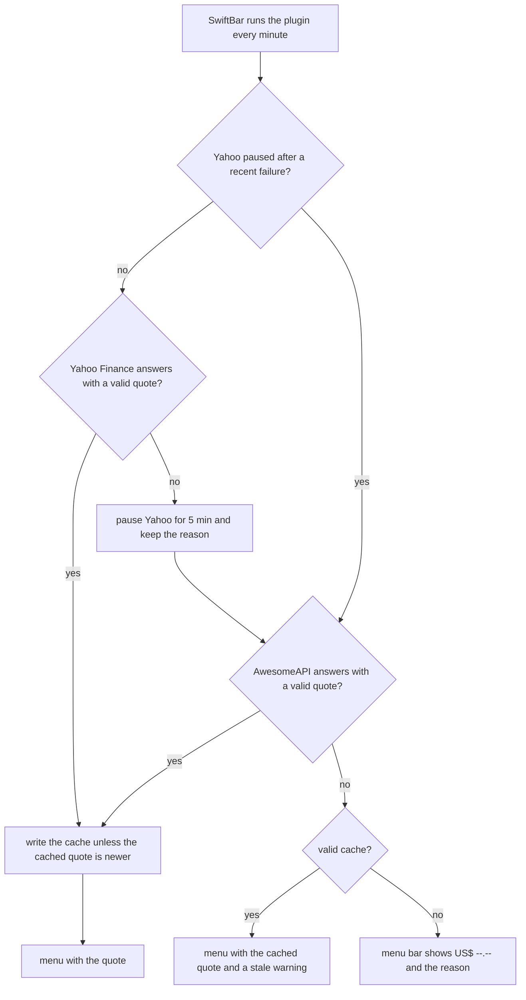

# How the plugin works

SwiftBar runs the wrapper `usdbrl.<interval>.sh`, which holds the menu metadata and forwards refreshes and menu actions to the Go binary in `~/Library/Application Support/usdbrl-swiftbar/bin/usdbrl`. The file name still controls the refresh interval.

## Flow

## Choosing the sources

The sources were compared on 2026-11-26 by querying each one directly.

| Source | Freshness | Key | Day high, low and change | Outcome |
|---|---|---|---|---|
| Yahoo Finance chart endpoint | 1 to 11 s behind | no | yes | primary |
| AwesomeAPI `/json/last` | new quote every ~5 min, CDN cache up to 5 min | no | yes | fallback |
| Google Sheets `GOOGLEFINANCE` | up to 20 min | Sheets only | no high or low for currencies | rejected |
| Banco Central PTAX | a few bulletins a day | no | no | rejected |
| Frankfurter and open.er-api | daily | no | no | rejected |
| Binance `USDTBRL` | real time | no | 24 h window | rejected, prices USDT instead of USD |

Yahoo's chart endpoint isn't documented, has no published rate limit and Yahoo's terms reserve the data for personal use. That's why AwesomeAPI stays as a documented fallback and why Yahoo is paused for 5 minutes after any failure instead of being retried every minute.

Yahoo answers `USDBRL=X` with either `USDBRL=X` or its alias `BRL=X` in the `symbol` field, so the plugin accepts both as long as `currency` is `BRL`.

AwesomeAPI is served through a CDN with `Cache-Control: max-age=300` and rejects random query strings with a `301` and an `x-api-warn-message` header, so the plugin never tries to bypass its cache.

## Fields and the daily change

| Value | Yahoo Finance | AwesomeAPI |
|---|---|---|
| Rate | `regularMarketPrice` | `bid` |
| Daily change | `regularMarketChangePercent` | `pctChange` |
| Day high | `regularMarketDayHigh` | `high` |
| Day low | `regularMarketDayLow` | `low` |
| Source time | `regularMarketTime` | `timestamp` |

Both sources measure the daily change against the previous close, not against the previous check. On 2026-11-26 Yahoo reported `previousClose` 5.821, and the AwesomeAPI `bid - varBid` matched the same 5.8210 close from its daily history endpoint. The menu shows only values the source returned, rounded to two decimals.

## Validation and cache

A response is accepted only when all of these hold.

- The JSON parses and the pair matches USD/BRL.
- Rate, high and low are decimal numbers and the rate is above zero.
- The daily change is a decimal number with an optional sign.
- The timestamp is a 9 to 11 digit integer.

The quote is stored as one tab-separated line in `~/Library/Caches/usdbrl-swiftbar/last.tsv`, with mode 700 on the directory and 600 on the file. Writes go through a temporary file and an atomic rename. Reads validate the line again. When a source returns a quote older than the cached one, the plugin keeps the newer quote, which avoids jumping back in time after a fallback.

## Stale states

- Every source fails. The menu bar text gets a `⚠` suffix and the menu shows the reason and the time of the last successful check.
- The source hasn't published a new quote for more than 15 minutes. The menu shows a warning and the menu bar text stays the same, because a closed market looks the same.
- Every source fails and there's no valid cache. The menu bar shows `US$ --.-- ⚠`.
- The home directory can't be found. The menu bar shows `US$ --.-- ⚠` and the reason, and the plugin reads and writes nothing. `--version` and runs that set both state directories still work.
- Yahoo fails and AwesomeAPI answers. The menu shows which source failed, why, and that AwesomeAPI is in use.

Invalid responses include the HTTP status in the reason. The plugin reports missing quotes through its menu and exits successfully, so SwiftBar can show the reason and keep the actions available.

## Alerts

Each alert is one `above <rate>` or `below <rate>` line in `~/Library/Application Support/usdbrl-swiftbar/alerts`, with mode 600. The direction comes from the cached rate when the alert is added. Alerts are checked whenever a source responds, against the rate shown, which is the cached one when the cache holds a newer quote. They are never checked after every source failed, so a stale rate never fires one. A fired alert sends one notification and is removed.

Alerts work at the precision the menu bar shows. New targets are stored with up to two decimals, and both values are rounded before comparison, so a rate of 5.7351 shows as 5.74 and fires a 5.74 alert. The plugin preserves the text of existing targets until they are removed.

The target typed in the dialog and the notification text reach AppleScript as `on run` arguments, never spliced into the script source, and the target must be a positive decimal number.

## Privacy

Requests carry the URL, an `Accept` header and the user agent `usdbrl-swiftbar/1.0`. No cookies, credentials or computer identifiers are sent beyond the IP address that any connection exposes.
## Higlobe monthly estimate

Payment estimates live in `internal/payout`. The root package owns calculations and local state. `provider` fetches rates, and `desktop` serves the app's local protocol and contains its SwiftUI sources. `internal/menu` owns the provider submenu and menu-bar summary. The main plugin supplies the market quote and dispatches commands to the payout feature.

Choose **Higlobe → Open converter** to edit monthly payments and try one-off amounts. Each payment has a USDC amount and an optional name. The calculator icon opens an on-screen numeric keypad. Changes to a valid payment save when you leave its row or press Return. **Show in menu bar → Higlobe · USDC/BRL** displays the effective rate and adds the estimated BRL total when you have saved payments. Switch back to **USD/BRL rate** at any time without deleting the payments.

While **Higlobe · USDC/BRL** is selected, SwiftBar updates the rate at the configured refresh interval. Choose **Update rate** in the converter to check immediately. The request uses a fixed sample amount. The plugin keeps your names and individual amounts on this Mac and uses the returned rate to calculate your estimates locally. SwiftBar's debug output can include the aggregate shown in the bar. The bar marks the estimate as stale after an hour or a failed update. The public calculator rate can differ from the rate your account offers at withdrawal.
